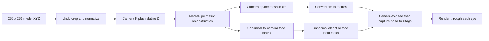

# Face transform from MediaPipe inference: first-principles audit

The follow-up [diagnostic measurement plan](DIAGNOSTIC_MEASUREMENT_PLAN.md) specifies the board, physical setup, capture holds, measurements, existing capabilities and required diagnostic-build changes.

The correct starting point is MediaPipe's camera-space reconstruction with a camera model that describes the actual inference image, followed by a separately validated camera-to-Stage transform. The current geometry solver already implements MediaPipe's principal reconstruction algorithm. Replacing it with another constant or distance-dependent Y correction would not resolve the unverified camera and tracking-origin contracts.

The wearer reports that the experimental 40 mm downward shift helps nearby but puts the mesh too low farther away. This is direct physical feedback, without a new recording; no numerical distance or residual was measured. It prevents accepting the constant as a general correction. It does not yet identify a distance law or prove which calibration component is wrong.

This audit inspected official source, ran the official MediaPipe task locally, independently replayed 42 retained headset exports, and tested known synthetic geometry. It changed documentation and added host analysis artifacts only. No app/service source, installed APK, calibration, device process, recording or Git history was changed.

## Reference and evidence

MediaPipe reference: **v0.10.32**, commit **8317ba78778738ba90a521e7e4580a2ba0129c81**, matching the version used by the original port's reference harness. This is a pinned reference, not a claim about every MediaPipe release or the wearer's particular webcam/phone application.

- [Official geometry pipeline](https://github.com/google-ai-edge/mediapipe/blob/8317ba78778738ba90a521e7e4580a2ba0129c81/mediapipe/tasks/cc/vision/face_geometry/libs/geometry_pipeline.cc): `ScreenToMetricSpaceConverter::Convert`, `ProjectXY`, `MoveAndRescaleZ`, `UnprojectXY`.
- [Official weighted Procrustes solver](https://github.com/google-ai-edge/mediapipe/blob/8317ba78778738ba90a521e7e4580a2ba0129c81/mediapipe/tasks/cc/vision/face_geometry/libs/procrustes_solver.cc): rotation, uniform scale, translation, reflection rejection.
- [Default environment and iris removal](https://github.com/google-ai-edge/mediapipe/blob/8317ba78778738ba90a521e7e4580a2ba0129c81/mediapipe/tasks/cc/vision/face_geometry/face_geometry_from_landmarks_graph.cc): top-left origin, 63-degree vertical FOV, near plane 1 cm, far plane 100 m, first 468 landmarks.
- [Landmark crop projection](https://github.com/google-ai-edge/mediapipe/blob/8317ba78778738ba90a521e7e4580a2ba0129c81/mediapipe/calculators/util/landmark_projection_calculator.cc): XY crop inversion and Z scaling.
- [Reference source manifest](../artifacts/facelandmarker/registration-lab/mediapipe-first-principles-2026-11-05/upstream-manifest.json), [executable audit](../artifacts/facelandmarker/registration-lab/mediapipe-first-principles-2026-11-05/audit.py), [full results](../artifacts/facelandmarker/registration-lab/mediapipe-first-principles-2026-11-05/audit-results.json), [run log](../artifacts/facelandmarker/registration-lab/mediapipe-first-principles-2026-11-05/audit.log).
- [Local source snapshots and hashes](../artifacts/facelandmarker/registration-lab/mediapipe-first-principles-2026-11-05/evidence-manifest.json): 22 app/service files, checkout revisions and verified task-bundle hash.
- [Synthetic perspective check](../artifacts/facelandmarker/registration-lab/mediapipe-first-principles-2026-11-05/synthetic-perspective-check.json): 24 known poses, 0.4–3 m translation depth, 0/20-degree pitch and two vertical positions.

## What the default implementation actually returns

The neural model outputs **478 crop-relative XYZ landmarks**, not a metric head pose. X/Y are coordinates in its 256×256 input. Z is a learned relative-depth value with a normalization related to X; it is not a range measurement in metres. MediaPipe restores the crop's position, rotation and scale before performing geometry reconstruction.

There are three distinct outputs/use cases:

| Output | Meaning | What a good overlay establishes |
|---|---|---|
| Normalized screen landmarks | Points in the input image; draw at `(x W, y H)` | Localization on that image |
| Facial transformation matrix | Similarity transform from the canonical face to the reconstructed face in the configured virtual camera | Placement relative to that camera and canonical size prior |
| Runtime geometry | Deformed face-local vertices plus the facial matrix | A face mesh that projects back onto the input landmarks under that same camera |

A webcam display can draw screen landmarks without using a face matrix at all. A 3D webcam effect can use the default matrix and a matching virtual rendering camera. Neither alone measures physical distance from the device. Phone products may also add their own calibrated camera/depth/tracking integration; the example the wearer used has not been inspected.

The standard task graph's fallback camera has `fy = fx = H / (2 tan(63°/2))`, `cx = W/2`, `cy = H/2`. It is a virtual perspective camera at the origin looking along **negative Z**, with **X right, Y up**, in centimetres. The default graph accepts an alternative environment internally; the fallback itself does not know the actual webcam/phone focal length. Its camera schema exposes vertical FOV and clipping planes, rather than a general off-axis K.

## Derivation from our inference tensors

Let `A` map native source pixels to the working image and `C` map working pixels to the model crop. The source-to-model operation is `C A`.

1. Recover image positions with `p_work = inverse(C) p_model`. If working in the original source frame instead, use `p_source = inverse(A) inverse(C) p_model`. Normalize X by image width and Y by image height. Preserve the crop/resize/rotation provenance.
2. Use the intrinsics of that same frame: **`K_work = A K_source`** for the current affine resampling. Camera intrinsics, image dimensions and landmark coordinates must describe one image. A display-eye FOV is not a source-camera K.
3. For near plane 1 cm, create near-plane coordinates:

   ```text
   r_x = (x W - cx) / fx
   r_y = (cy - y H) / fy
   r_z = z W / fx
   depth_offset = mean(r_z over the first 468 landmarks)
   ```

   The full-K equations are our generalization of MediaPipe's symmetric frustum. They exactly reduce to the upstream equations for its default K.
4. Fit the canonical face to `[r_x, r_y, -r_z]` with upstream weights to estimate scale `s1`. The canonical asset has 468 points; only 33 have positive fitting weight. Iris points do not determine the pose or the depth mean.
5. Unproject once with `s1`, fit again to obtain `s2`, and unproject again with `s1 s2`:

   ```text
   d_i = (r_zi - depth_offset + 1) / (s1 s2)
   Q_i = [r_xi d_i, r_yi d_i, -d_i]       # camera-space centimetres
   ```

6. The final weighted similarity fit gives **`T_cm = [s R, t_cm; 0, 1]`**, mapping canonical face coordinates to the reconstructed camera-space face. Rotation is constrained to be proper; the SVD reflection correction matters. The matrix's 3×3 part includes uniform scale, so it is not generally a pure rotation.
7. Upstream localizes the deforming mesh with **`U_cm = inverse(T_cm) Q_cm`**. It publishes this mesh together with `T_cm`. Applying the face matrix to already camera-space `Q` would apply pose twice.

For physical Stage coordinates, let `E` map the camera represented by the supplied image into the tracking head frame and `H(t_capture)` map that same head frame into Stage. Define `D = diag(.01, .01, .01, 1)`:

```text
T_m = D T_cm inverse(D) = [s R, .01 t_cm; 0, 1]
T_stage_face = H(t_capture) E T_m
U_m = .01 U_cm
Q_stage = T_stage_face U_m
```

Equivalently, for the live deforming mesh:

```text
Q_stage = H(t_capture) E (.01 Q_cm)
```

The face pose is useful for attaching a canonical object; it is not an additional correction to already camera-space vertices. In this Kotlin path both frames are right-handed; there is no Unity Z reflection. A canonical asset stored in metres uses `T_m`; if an asset stays in centimetres, its unit conversion must instead be included explicitly at the vertex/transform boundary.



The matrix route shown for an attached object includes the corresponding cm-to-m conversion described above. Eye projection happens at rendering time; it must not be substituted into source-camera reconstruction. Motion introduces an additional exposure/display timing problem; static calibration should establish the geometry first.

## What is verified about the current implementation

The existing `geometry_project.js`, `geometry_unproject.js`, `geometry_covariance.js` and `geometry_solve.js` implement those equations. The optimized control model was compared through **actual retained production outputs**, rather than only trusting generator/JS agreement.

| Independent check | Result |
|---|---|
| Canonical XYZ against official metadata | Maximum 4.67e-7 cm, consistent with stored float32 precision |
| All upstream landmark weights | Maximum difference 4.86e-16; 33 positive weights |
| Reference transcription against actual MediaPipe task matrix, same returned landmarks | Maximum matrix-element difference 1.878e-4; translation units are cm, hence at most 0.00188 mm translation difference |
| Current JS geometry against the same actual task matrix | Maximum 1.868e-4, with the same unit distinction |
| Independent reconstruction against 42 saved production fit poses | Maximum 5.140e-5 in matrix elements, at most 0.000514 mm translation difference |
| Reconstructed camera vertices against saved metric vertices | Maximum coordinate difference 7.194e-5 cm = 0.000719 mm |
| Direct `H E (.01 Q)` against all saved Stage vertices | Maximum coordinate difference 8.386e-7 m = 0.000839 mm |

The task comparison attempted 15 images from five retained exposures: source images, affine-resampled working images, and saved model crops. Eight produced faces and supplied matrix comparisons, including all five model crops. Seven full-frame attempts had no detection from the official short-range task detector. They remain recorded as failures to detect, not omitted successful cases. Our app uses a different long-range detector/ROI path.

On the five saved model crops, independent task detection/inference differed from the saved raw landmarks by 1.16–1.98 model pixels RMS. The task chooses its own crop, so this is not an exact same-tensor inference comparison. It is evidence against a gross XYZ/image-orientation mistake, not proof of learned-landmark accuracy. The original port's old end-to-end test permitted up to 2 cm pose-translation difference while also changing detection; it was insufficient as a strict pose-equivalence test. The new same-landmark comparison avoids that confound.

For Current, size scale 1 and raw pose, our service packer computes approximately `C_service (.01 Q_camera)`; the app then applies `H E inverse(C_service)`. The service frame cancels. This audit verifies that algebra numerically on all 42 exports. It does **not** verify that the physical origin represented by `E` is the one represented by `H`.

The synthetic known-pose cases recover the input geometry at numerical precision with matching camera parameters. Deliberately reducing both focal lengths by 13% still gives essentially zero self-reprojection error, while the recovered pose depth is about **127 mm wrong at 1 m** and **257 mm wrong at 2 m**. This is a controlled demonstration of why a perfect source overlay/round trip does not establish physical metric geometry. It is not a fit to the wearer or an estimate of this headset's depth error.

## A confirmed difference from the default implementation

Upstream's `LandmarkProjectionCalculator`, on the `IMAGE_DIMENSIONS` path used by this task version, sets Z scale from the length of the rotated ROI X basis in **normalized image coordinates**. For our square ROI with pixel side `L` and angle `theta`:

```text
upstream z = (raw_z / 256) sqrt((L cos(theta)/W)^2 + (L sin(theta)/H)^2)
current  z = (raw_z / 256) L/W
ratio      = sqrt(cos(theta)^2 + (W/H)^2 sin(theta)^2)
```

These agree for zero roll or square images, but differ for rotated crops in the 3248×2464 image. The current formula appears in `track_landmarks.js`, `mesh_landmarks.js`, the fused control generator and related output paths. A strict parity change must update every consumer/generator and regenerate its model assets, not only the diagnostic JS.

In the 42 saved exports, the upstream/current Z ratio reaches **1.06457**. Replaying with upstream Z normalization changes pose translation by at most **0.575 mm X, 0.721 mm Y and 10.049 mm Z**; maximum full-mesh difference is 10.397 mm RMS, mainly depth. The near/mid/far frontal MARKED exports have less than 0.04 mm Y change. This is a real reference-compatibility difference, but it does **not** account for the roughly 40 mm vertical effect. Adopting the upstream convention would establish compatibility with this pinned version, not by itself prove better physical calibration.

## The unresolved physical inputs

### Intrinsics must describe the returned image

The current C working camera uses `fx = fy = 1746.4713`, with the preserved horizontal image affine. Its source-equivalent K has `fx = 2275.9771`, `fy = 1746.4713`, `cx = 1623.5000`, `cy = 1231.5`. These values originate from the earlier 70.400002-degree renderer hypothesis, not an accepted source-camera calibration.

The retained service K is `fx = 2065.5898`, `fy = 2089.4355`. The inspected local OpenMR source calls `getCameraIntrinsics(width, height, 76.35, 61.05)`; its returned values match that FOV-based pinhole model. This is a query parameterized with fixed output FOV values, not evidence that those values match the exact returned image in the current capture mode. The native API implementation and current ROM's complete image/rectification contract were not inspected or measured in this turn.

The earlier board fit gives source `fx = 2642.7047`, `fy = 2036.9553`, `cx = 1672.3769`, `cy = 1230.3376`, and has held-out source-image support. Yet using it worsened recorded-eye face overlap. That does not make a renderer-derived K physically correct: source-image calibration, face-depth estimation and camera-to-eye registration are different constraints. The [earlier board and face replay](../artifacts/facelandmarker/registration-lab/roll-trial-2026-11-05-b8c6a3/FINDINGS.md) is retained; no value is promoted here.

Simply copying default 63-degree K into the existing world-space path also fails to preserve the current physical-camera rays. On the same saved inference outputs, it moves face-pose depth about 96–187 mm farther in the representative MARKED exports. Projecting those new vertices through the old C camera gives 13–93 native pixels RMS across all exports. A matching 63-degree virtual renderer can reproject them correctly in an image preview; our physical eye renderer does not thereby become that virtual camera.

### The extrinsic and tracking head origins must agree

`CameraCalibration.cpp` forms `E = imuToHead × leftOpticalToImu`. Its IMU-to-head translation is copied from the OpenMR convention. The local service source itself labels that translation hardcoded and says it should come from `/system/etc/pvr/config/config_head.txt`.

Follow-up evidence (2026-11-06 device date): [user-enabled root inspection](../artifacts/facelandmarker/registration-lab/device-calibration-root-2026-11-06/FINDINGS.md) proves that the comment's named file is absent. The actual `calib/imu0/sensor.yaml` contains `T_IH`, labelled `IMUFromHead`. Direction inversion is explicit, but its basis/order relative to the capture API and SDK head pose is not established; no substitute matrix is accepted. Camera sensor YAML also differs in size/orientation/lens model from the returned image. These findings refine the unresolved contract below without changing this audit's numerical MediaPipe/algebra results.

The app's `H` comes from `HMDTrackingProvider`. Nothing established in this audit proves that its physical origin equals the OpenXR view origin assumed by that fixed conversion. `E` must also describe the camera coordinate frame of the **returned rectified image**, which need not be identical to an unrectified sensor frame. Multiplying valid rigid matrices with mismatched semantics can produce a consistently wrong physical result.

Local service source was read at checkout HEAD `1dcbf2dff56f561fdea3327f72453435df4f4f19`; it has unrelated working changes. These source findings are not a fresh verification of the installed ROM/service binary. Neither service nor headset was changed.

`StagePoseHistory` uses callback-arrival time because the public Kotlin path does not provide a verified exposure-clock tracking timestamp. This remains a motion limitation. It is not a demonstrated explanation of a persistent static distance trend.

### Monocular metric scale remains a prior

MediaPipe's centimetres come from the canonical face and its reconstruction assumptions. A larger face farther away and a smaller face closer can generate similar source rays. Metric depth, scale and shape are not independently measured by those landmark tensors. Accurate binocular physical placement may require a calibrated stereo/depth observation or a measured subject/target constraint. A PnP fit to canonical 3D landmarks is a useful independent pose baseline, but it also inherits the canonical-size/shape assumption; it cannot remove monocular scale ambiguity by itself.

## Implementation and regression path

The recommended implementation keeps the proven MediaPipe solver and gives each boundary a direct test:

1. **Reference image preview.** Add an isolated lab view containing the exact inference source/crop and its raw 2D landmarks. For a 3D preview, render the reconstructed mesh with the same declared virtual K and image viewport. This establishes the same guarantee as a webcam effect, without requiring the headset's physical eye mapping. Retain raw inference outputs and matrix comparisons from this audit as the numerical baseline.
2. **One explicit camera-space result.** Expose the reconstructed camera-space metric vertices and canonical-to-camera transform, with K, image affine, coordinate origin and timestamp attached. For the Stage mesh, the direct path is `H E (.01 Q)`. This is algebraically equivalent to the current pack/unpack path and can initially be a diagnostic comparison, preserving graph completion and packet coherence. Do not attach the face transform a second time to those vertices.
3. **Reference parity at rotated crops.** If exact v0.10.32 compatibility is the intended contract, update Z normalization in all JS/generated paths and regenerate assets. Cover rectangular and square images, positive/negative roll, zero roll, all 468 depth-mean points, sparse/full weighted fits and unchanged source XY rays. Compare against upstream equations and actual task outputs, not only one port against another. This change is bounded and is not presented as the vertical-registration fix.
4. **Calibrate the camera-to-Stage path independently of a face.** Use a measured rigid board visible in the exact source stream and both eye views, at independently measured near/mid/far positions. Estimate board corners in camera coordinates with the source K, then draw those corners through the same `H E` path. Keep head level first, then add controlled pitch/roll. If this misses physical corners, fix the source/rectification/extrinsic/head-origin contract before tuning face geometry. Earlier board captures lack the current paired-eye reference protocol, so they cannot complete this test alone.
5. **Only then test face depth/shape.** If the rigid target aligns but the face does not, compare reconstructed face depth against synchronized stereo/depth or another independent metric constraint. Evaluate multiple distances and a second subject. If only motion fails, investigate capture/display timing separately.

Acceptance is staged: source-image reference equivalence; independent metric target registration in both eyes; then real-face overlap across distance and orientation. A small model-space reprojection error is only the first part. The 40 mm toggle remains an unaccepted experiment; this audit proposes no new distance-dependent offset and does not apply one.

## Reproduce

Use Python 3.12 with `numpy==2.2.6`, `opencv-python-headless==4.12.0.88` and `mediapipe==0.10.32`, plus Node.js. The retained task bundle is under `rom-services-one-check-2026-11-04/analysis/face_landmarker.task`; its expected SHA-256 is `64184e229b263107bc2b804c6625db1341ff2bb731874b0bcc2fe6544e0bc9ff`.

```sh
python artifacts/facelandmarker/registration-lab/mediapipe-first-principles-2026-11-05/audit.py
python artifacts/facelandmarker/registration-lab/mediapipe-first-principles-2026-11-05/audit.py --synthetic-only
```

On macOS this MediaPipe build creates an OpenGL context for preprocessing even when model inference uses CPU. The initial sandboxed attempt failed at context creation; the authorized run outside that sandbox completed. The script directs matplotlib/cache output into its artifact directory. Source/reference images and model files remain local; only public upstream source was downloaded.
