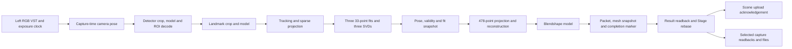

# Face tracking computation and performance — 2026-10-31

Live update: [PIPELINE_PERFORMANCE_LIVE_2026-10-31.md](PIPELINE_PERFORMANCE_LIVE_2026-10-31.md) now measures all 39 operators on 106 complete current-build frames, plus normal tracking/readback/upload timing. The disconnected analysis below is retained as historical evidence and its pending-live statements are superseded by that report.

The saved Kotlin runs put most of the observed steady tracking interval before result readback. In the latest substantial face-bearing session, 1,034 non-export face frames have **232.8 ms median / 280.4 ms p95 submission-to-readback**, versus **3.2 ms median / 14.0 ms p95 readback-to-SDK-upload** for its 804 presented pairs. Accepted exports add **844.3 ms median** from readback to their save journal event. Individual Kotlin operator costs remain unmeasured: the headset was disconnected throughout this analysis, and the retained logs contain no structured operator timing events.

These are historical observations on diagnostic APK `26b7b626ad0b5281b5b0cb7d3db2e1f0f3428ee6cc00c2aa52170cbcbe902e60`, before the completion repair. Four known mismatches are excluded from the non-export population, but other ordinary frames were not compared against their snapshots. The reported readback endpoint could be premature. They establish the observed timing envelope, not a trustworthy current-build benchmark or a model/service root cause. The 18 accepted exports independently passed exact packet and native consistency checks; their selected population provides a narrower coherent timing reference.

The current installed completion repair is APK `39861cdf012e99ddfcbb8218dfe5c08a6f28ef00add89915bb0a85753e4906fb`. Its face-bearing completion timing must be measured separately. No app, graph, calibration, headset property or service change was made during this performance analysis.

## Computation path

The lab invokes detection every frame. The normal sample has a separate predicted-ROI producer that skips detector crop/model/decode while tracking; the lab currently cannot use that path without revisiting exported detector-image evidence. The current lab executes **39 operators per ordinary frame**: 11 detector/acquisition, 20 landmark/fit, and 8 mesh/output. Selected exports submit a separate 2-operator source-capture pipeline. The normal sample has 32 operations for detection frames and 27 for tracked-ROI frames. These counts come from executing the production graph constructor with host adapters, not from textual guesses. They do not measure runtime.

## Available Kotlin timings

Data source: session `2026-10-31T18-10-01.419367Z-a197a4`; 1,067 completed journal frames, 1,065 face-bearing, 18 accepted exports and 4 rejected packets. The first 10 frames are excluded from journal distributions.

| Boundary / population | Count | Median | p95 | Meaning |
| --- | ---: | ---: | ---: | --- |
| Submission → result readback, non-export face frames | 1034 | 232.8 ms | 280.4 ms | Graph, queue, Binder/copy and polling combined; legacy completion caveat |
| Readback → SDK upload, paired non-export face frames | 804 | 3.2 ms | 14.0 ms | Stage/validation/UI scheduling/upload handoff combined |
| Exposure age at SDK upload, same paired population | 804 | 272.1 ms | 519.9 ms | Recorded exposure → upload acknowledgement; excludes rejected/unpresented frames |
| Submission → next submission, excluding export intervals | 1034 | 245.4 ms | 294.5 ms | Mean included cadence 3.94 Hz; completion rate, not headset refresh rate |
| Readback → next submission, excluding export intervals | 1034 | 12.7 ms | 17.4 ms | Includes deliberate 10 ms delay and host work; separate from overlapping upload |
| Readback → accepted save event | 18 | 844.3 ms | 919.7 ms | Source pipeline, all image/probe reads, validation, JSON and PPM IO combined |
| Submission → next submission, export/rejection intervals | 22 | 1082.6 ms | 1188.6 ms | Inference pauses while export/diagnostic work settles |
| Submission → readback, independently coherent accepted exports | 18 | 227.9 ms | 261.1 ms | Selected stable population; all exact packets accepted |
| Exposure age at readback, same coherent exports | 18 | 258.0 ms | 285.0 ms | Narrow successful sample; not a random tracking benchmark |

The paired exposure age at readback is 269.1 ms median versus 272.1 ms at upload. Medians of different populations must not be subtracted to estimate stage cost. Direct paired readback/upload deltas are used above. Upload work can overlap the inference loop; it must not be added again to submission cadence.

The earlier `b2b8c9a3` check had 138 non-export face frames after warm-up: 413.6 ms median / 687.6 ms p95 submission-to-readback, with 10.0 ms median handoff in 113 presented pairs. Its three exports took 1,566.7 ms median after readback. The scene, load, subject and thermal state were uncontrolled. The later lower numbers do not establish a performance improvement.

Repeated-exposure presentation rejection occurred on 231 of 1,067 frames (21.7%) in the later substantial session; one further frame had an invalid sensor clock. The app's raw freshness field marked only three frames unfresh, so it must not be used alone as the repeated-exposure rate. These rejected frames still consumed graph work. The later short camera-stop session and the earlier slower session are retained as separate populations.

## Per-component inventory and measurement gaps

The current Kotlin columns below are explicitly pending live timing. Unity numbers are the saved October 26 **trace-enabled means** through the XR service; they are not estimates of Kotlin runtime. The normal Unity mesh latency with tracing off was 51.80 ms mean and 19.22 completion Hz (18.40 measured-face Hz). Its trace-enabled latency rose to 75.20 ms over a changing scene, so logging materially affects comparisons.

| Piece | Current Kotlin operation(s) | Kotlin runtime | Saved Unity mean |
| --- | --- | --- | ---: |
| RGB VST acquisition | RectifiedVSTAccess, native 3248×2464 RGB | Pending | 4.678 ms tracked / 4.86 ms detection |
| Camera pose | CameraSpaceToWorld | Pending | 0.141 ms |
| Virtual camera values | lab_camera JS | Pending | Different path |
| Detector preprocessing | lab_affine, affine crop, byte→float, /255 | Pending | 2.147 ms |
| Detector inference | face_detector, 256×256 RGB | Pending | 2.254 ms |
| Detector decode and ROI | decode_detection and prepare_roi JS | Pending | 3.889 ms decode; 0.83 ms acquisition ROI |
| Predicted ROI producer | VST, camera values/pose, prepare_roi, snapshot | Pending; lab does not select it | 1.321 ms ROI plus acquisition/pose |
| Producer snapshot | lab_frame_snapshot, 66 floats | Pending | No equivalent lab snapshot |
| Landmark preprocessing | lab_affine, affine crop, byte→float, /255 | Pending | 2.289 ms |
| Landmark inference | face_landmarks_detector | Pending | 2.337 ms |
| Landmark decode/tracking | track_landmarks, 33 weighted points | Pending | 2.963 ms |
| Three fits | 3× covariance JS, native 3×3 SVD, solve JS | Pending | 6.420 ms native fits including SVD |
| Three SVD calls alone | Native SVD; subset of fit row | Pending | 0.208 ms, already included above |
| Sparse reconstruction | 2× geometry_unproject on 33 points | Pending | 1.965 ms |
| World pose/filter | face_pose JS | Pending | 1.784 ms |
| Registration checks | registration_diagnostics JS | Pending | 1.266 ms |
| Fit snapshot | lab_geometry_snapshot, 1995 floats | Pending | No equivalent lab snapshot |
| Full landmark/gather | mesh_landmarks, 478 points / 146 blendshape inputs | Pending | 3.408 ms native |
| Full projection | geometry_project JS, 478 points | Pending | 2.008 ms |
| Full reconstruction | geometry_unproject JS, 478 points | Pending | 1.270 ms native |
| Blendshape scaling | Native /1024 | Pending | 0.055 ms |
| Blendshape inference | face_blendshapes, 52 outputs | Pending | 2.336 ms |
| Metric mesh transformation/packing | pack_service_result JS, 2994 floats | Pending | 0.604 ms local vertices + 1.967 ms pack |
| Mesh snapshot | lab_geometry_snapshot, 9395 floats | Pending | No equivalent lab snapshot |
| Terminal completion | lab_capture_marker, final operator | Pending on repaired build | Different completion path |
| Queue/dispatch/logging gaps | Task/operator timestamp reconciliation | Pending | 8.169 ms common + 5.486 ms mesh traced gaps |
| Result IPC/polling/copy | Completion polling and 2994-float readback | Included in aggregate only | Readback waits overlap execution |
| Stage rebase/validation/upload | Kotlin plus Spatial SDK/ECS | Combined 3.2 ms median in legacy pairs | Unity apply 0.250 ms mean, different boundary |
| Source capture and exports | 2 operators, four image/probe reads, PPM/JSON writes | Combined 844.3 ms median after readback | Sampled diagnostics, different evidence path |
| GPU/compositor presentation | Spatial runtime and passthrough compositor | Unmeasured | Unmeasured motion-to-photon |

The landmark and blendshape model files are byte-identical across the inspected projects; detector files differ. Unity used Qualcomm DispatchDelegate in one partition for each model; Kotlin's executing delegate has not been verified in this analysis. An app backend integer is insufficient to claim effective NPU execution. Kotlin uses the Spatial service/BOM 6.1.9; Unity uses the XR service/SDK 6.2.0. Service binary/partition/delegate/runtime differences require a current provenance capture.

## Data moved by the diagnostic path

Per frame, producer/fit/mesh snapshots write 66/1995/9395 float32 elements (264/7980/37580 bytes), a combined 45,824 bytes. The final result is 11,976 bytes. Selected exports read a 6,002,304-byte source RGB image, two 196,608-byte crops and the 37,580-byte mesh probe: **6,433,100 bytes**, before JSON/PPM overhead. The detector/landmarker float RGB tensors are each 786,432 bytes at 256×256×3; these are intermediate tensors, not host transfers on every frame.

These are source-derived byte volumes, not measured bandwidth costs. JavaScript array/context marshaling, camera affine work, readback IPC and snapshot copying need actual service timing. The existing JSON and PPM save routine has no per-file clocks; its 844 ms combined interval must not be called pure disk time.

## Measurement plan and priorities

1. **Measure the repaired build with a face and tracing off.** Reconnect PB311XHGKC220141G, verify idle capture, hash, ROM, service binary, delegate, thermal state and calibration. Keep the face in view. Repeat the baseline after tracing to expose diagnostic overhead; do not record a candidate sweep during the benchmark.
2. **Time all service operators.** The actual layout is saved as `performance-data/operator-layout.md` and `graph-layout/operator-layout.json`. `tools/capture_face_pipeline_perf.py` prepares trace-off/operator-trace/trace-off windows, preserves the original debug property and releases devmux. Tracing temporarily enables device-wide logging and a readback permission bypass. It does not change calibration or install another APK. `tools/analyze_spatialml_trace.py` retains only complete successful tasks, isolates service/client/task handles, validates native operator types and reports operator sums, pipeline execution and gaps separately.
3. **Resolve the long pieces before choosing an optimization.** Candidate experiments are detector-on-search versus forced detection, omitting unused blendshapes, sampled diagnostic snapshots, and JS/copy/affine optimization. Costs are unmeasured in Kotlin; no speedup is promised. Changes to detector scheduling must preserve coherent export images, and changes to snapshots must retain exact accepted sample evidence.
4. **Instrument host/export substeps only where the trace leaves a gap.** Separate completion polling/readResult, Stage rebase, motion checks, capture readiness, each image readback, native probe comparison, JSON serialization and each file write. These require additional scoped timing instrumentation; current journals expose only combined intervals.
5. **Capture Perfetto for IPC/scheduling/rendering attribution.** A long submit/readback interval alone cannot distinguish model execution, blocked camera, JS, service queue or Binder copy. GPU/compositor and frame-budget categories remain undetermined without matching SpatialFrames, thread states, Binder caller/callee and GPU evidence.

Unity's literal many-node native migration regressed 40.64→48.34 ms despite reducing JS time. Kotlin already has 33-point fits, RGB and dependency ordering; it has far fewer nodes. That result argues for end-to-end validation of a targeted/fused change, not copying the native graph wholesale.

Lower latency should reduce motion-dependent face/overlay error and repeated/stale exposures; the existing stationary upward alignment residual still requires the cy/focal calibration experiments. Performance improvement alone does not prove optical correction.

## Evidence and current completion boundary

Session artifacts: `artifacts/facelandmarker/registration-lab/performance/session-output-20261031-211244/`. Staged/hash-recorded inputs, journal statistics, coherent-export statistics, full production-constructor operator mapping, parser regression evidence and the Unity baseline are under `performance-data/`. The topic/final report and HTML are generated from these measurements.

`tools/analyze_pipeline_journal.py` reproduces the journal timing distributions. `tools/face_pipeline_layout.py --json-jar /private/tmp/face-calibration-tuner/json.jar --output <directory>` executes current graph construction with host adapters. The trace parser passed complete-task/missing-event/process-isolation/duration reconciliation fixtures. The live capture helper compiled and its command-line surface was checked; device behavior is untested because the headset is disconnected.

The source map, saved timing analysis and reusable profiling tools are complete. Live per-component measurements on the repaired Kotlin build remain pending connection. No performance optimization, profile change, new build/install, headset mutation, commit or push occurred in this pass.
