# Efficient SpatialML pipelines when readback is available

For the face tracker, compare **image acquisition, inference and all required internal consumers in SpatialML, compact final landmark output, then app-only geometry and rendering**. Read back early only when the result is final for app consumption. Keep detector/ROI, tracker state and any features needed by later SpatialML stages inside the service. Prefer weightless tensor models for suitable bulk operations there. Choose among valid final-output boundaries by measured exposure-to-upload latency, useful frame rate and correctness.

This is a source-backed design and experiment plan, not an implemented replacement or a new device benchmark. It incorporates the user's clarification that compact readback applies to final app results, not intermediates that must return to SpatialML. The earlier app detector-decode and tracker-feedback proposals are withdrawn. Existing runtime code, model assets and installed build are unchanged in this design pass.

## What the current face benchmark establishes

Source: [RGB-first benchmark](RGB_FIRST_PIPELINE_BENCHMARK_2026-11-02.md), specifically its 27 uniquely matched eligible face chains, with tracing on. The mixed face/no-face top-level component statistics must not be used for these sums.

| Current work | Mean | Interpretation |
| --- | ---: | --- |
| 24 JavaScript operators | 239.18 ms | 78.2% of the 305.99 ms operator budget; includes wrappers and array marshaling |
| Five model calls | 27.00 ms | Two GPU preprocessing models and three trained models |
| Ten native operators | 39.81 ms | Includes camera, copies, SVD and pose acquisition |
| Work after landmark inference | 198.91 ms | Geometry, diagnostics, fit/mesh snapshots, blendshapes, packing and terminal marker; includes dependencies that must remain internal, so the whole tail is not eligible for app transfer |
| Lab byte-crop copies and all snapshots | 72.75 ms | Candidate for selected exports only; overlaps 46.22 ms of the preceding row |

The union of the last two rows is 225.43 ms, not their sum. Subtracting that union leaves 80.56 ms arithmetically, but it also removes internal tracking/blendshape dependencies that a valid final-output design must retain or replace inside SpatialML. **80.56 ms is neither a valid retained-graph budget nor a predicted frame time or FPS.** Recompute the candidate budget after classifying every dependency.

The tracing-off RGB-first median was 281.33 ms submission-to-terminal-readback and 328.70 ms exposure-to-upload acknowledgement. Upload acknowledgement does not establish compositor presentation. The earlier preprocessing change saved 6.51–6.91 ms in model calls without a consistent end-to-end gain against both controls. Optimize the complete path rather than extrapolating kernel improvements.

## Data movement and the useful readback boundary

| Payload | Logical bytes | Treatment |
| --- | ---: | --- |
| Full 3248×2464 RGB uint8 camera image | 24,009,216 | Keep in service; avoid repeated full-image input copies where runtime support permits |
| One 256×256 RGB byte crop | 196,608 | GPU sample first; export only on selected diagnostic frames |
| One normalized 256×256 FP32 crop | 786,432 | Feed inference in service; avoid app transfer |
| 896 detector anchors: 16 box/keypoint values + one score | 60,928 | Internal intermediate for this face graph; decode/ROI and landmark cropping stay in SpatialML |
| 478 raw landmark triples | 5,736 | Final app output candidate after required internal service consumers are handled |
| Current final packet | 11,976 | Contains both landmarks and derived vertices, plus other data |
| Proposed raw landmarks + 256-byte metadata allowance | 5,992 | Initial live mesh target; schema/layout still to implement |
| Same plus 52 blendshape scores | 6,200 | If expressions are needed |
| Proposed 33 fit-point triples + depth mean + metadata | 656 | Pose-only candidate; requires service quality checks/reductions over the full output |

These are payload sizes, not physical transfer measurements. Binder call count, snapshot allocation, shared-memory mapping, synchronization and polling also cost time. Compressing a roughly 6 KB packet with another GPU dispatch may lose more than it saves. Start with FP32 geometry; do not reduce timestamp, sequence or calibration precision to reduce a few bytes.

The current final packet is already small. The main purpose of an earlier final-output boundary is to move app-only transformations out of the service; approximately halving the payload is a secondary benefit. Compactness alone does not justify exporting an intermediate required by another SpatialML stage.

```mermaid
flowchart LR
    V["SpatialML: VST image + exposure metadata"] --> P["GPU: RGB crop then float normalization"]
    P --> L["NPU: landmark inference"]
    L --> F["Service quality, tracking state and required postprocessing / blendshape head"]
    F --> R["Completed compact packet: about 6 KB"]
    R --> A["App-only fit, mesh and presentation"]
    A --> U["App renderer: latest completed mesh"]
    F -->|"Retained internal state for next frame"| P
    V --> D["Acquisition only: detector preprocessing + inference"]
    D --> Q["Service decode / ROI candidate"]
    Q --> P
```



The acquisition dependency is detector → ROI → landmark crop on the **same retained camera image**. In steady tracking the detector path can be bypassed. The diagram describes dependencies, not simultaneous access to the current single global image or guaranteed shared GPU/NPU buffers.

## Boundaries to compare

| Candidate | Service work | App work | Tradeoff and priority |
| --- | --- | --- | --- |
| A: final landmark output | Camera/metadata, preprocessing, detector/ROI, landmark inference, required quality/tracker state and any requested service expression head, compact completion/publication | App-only sparse three-pass fit, pose/mesh transformations, diagnostics and rendering | First comparison after auditing dependencies; no app intermediate feeds later SpatialML work |
| B: final transformed landmark output | A plus fused inverse crop/gathers/reductions that benefit the app output | App-only fits and rendering | Compare with A; raw and transformed full-mesh triples have the same size, so fusion must earn its dispatch cost |
| D: service final geometry | Image/inference plus fused geometry/packing where supported | Final rendering | Only retain if measured faster than A/B; avoid recreating the expensive JS tail or hundreds of scalar operators |

The former candidate C (detector readback → app decode → ROI upload → landmark submission) is withdrawn: detector outputs are internal intermediates for this graph. Keep that dependency in SpatialML and optimize its implementation there. Likewise, do not export landmarks to prepare features that must be sent back to a service model.

After verifying that the output is final for the app and no later service stage depends on returning it or app-derived intermediates, compare:

`removed service time > added publication + added handoffs/waits + added app computation + downstream latency change`

Measure each term on matched workloads. The current 9.49 ms tracing-on outside-service residual combines submission/readback/polling; it is not an isolated IPC cost and cannot price an additional round trip.

## Weightless model placement

A weightless model contains tensor operations and fixed constants, without trained parameters. PyTorch is a suitable authoring tool if its exported TFLite graph supports the actual delegate. The artifact must execute and match the reference on this runtime; authoring language and requested backend do not prove acceleration.

| Operation | Recommended owner | Reason and acceptance boundary |
| --- | --- | --- |
| RGB crop, affine sampling, normalization | Existing two separate GPU models | Preserve detector/landmark specializations and sample bytes before full-frame float conversion |
| Detector sigmoid, box/keypoint decode, masks, winner selection, weighted suppression | Weightless service model candidate | Reduces 896 candidates to compact output and avoids a same-frame app round trip |
| Detector identity/expiry policy and ROI prediction | Service-owned state and supported fused/model/native processing | These values drive later SpatialML crops; preserve exposure-time evaluation and internal ownership |
| Inverse crop, fixed gathers, depth mean, min/max reductions | Fuse into landmark output model if profitable | Good fixed-shape tensor math; especially useful for pose-only output or blendshape features |
| Three sparse geometry fits, reflection correction and presentation filtering | App Kotlin or one JNI C++ bulk call, only where downstream consumers are all app-side | Keep any validity/tracking decisions needed by the service internal; audit consumers before moving a fit |
| Final mesh transforms and normals | App rendering owner | Vertices must reach that renderer anyway; avoid service → app → service loops |
| Packet concatenation, 264-byte producer snapshot, completion token | Existing producer output or compact native publication | A dedicated accelerator model for a tiny copy/marker is unlikely to pay; benchmark call count versus packing cost |
| Camera acquisition, pose lookup, service/App IPC and synchronization | Native runtime/SDK | These are I/O and lifecycle operations, not replaceable by a tensor math model |

The existing [detector fusion study](GPU_PREPROCESSING_IMPLEMENTATION.md#detection-decode-and-roi-fusion-feasibility) proves a fixed-shape algebraic rewrite against JS in 40 double-precision cases. It does **not** supply a deployed decode model or prove FP32/delegate parity. Preserve the actual single-winner weighted suppression, stable ties, invalid-value handling and identity ranking; do not substitute a different NMS algorithm under the same name.

For a detector model, test constant anchors, sigmoid, score/size/finite masks, winner reduction, IoU and weighted sums. Sanitize invalid values before arithmetic; multiplying NaN by zero does not sanitize it. Exact angle/ROI finishing is still a concrete implementation problem: the inspected GPU parser lacks direct ArgMax/Atan2 support. Test supported reductions and a cosine/sine crop contract against every fallback/roll case, or another supported service-side implementation. Do not use intermediate app readback to work around missing operators, or add a JS finishing stage as the intended final architecture.

Prefer appending fixed postprocessing to an existing trained model when it keeps a single supported partition and does not export intermediate tensors. A separate weightless model still incurs another wrapper call and input/output copies. Keep a separate-model control for numerical/debugging comparisons. Do not move an already fast NPU network wholesale to GPU solely to obtain graph fusion.

For blendshapes, preserve the exact 146-point gather, inverse crop to image pixels and division by 1024 before the 52-output head. If the head runs in SpatialML, prepare its inputs there and publish its final scores with the app's completed output. An entirely app-owned expression branch is an alternative only if no features return to SpatialML. The lab marker view does not consume blendshape scores, but changing its exported schema or removing inference requires explicit compatibility handling, not silently filling old fields with invented results.

## Current copies that model fusion alone does not remove

The local service source shows CPU access to camera AHardwareBuffer data and full RGBA→RGB materialization. `TFLiteModel::executeInference` copies each Engine input to its own LiteRT buffer, runs inference, then copies outputs back. Consequently the two preprocessing calls account for 48,018,432 logical full-image input-copy bytes on a detection frame. Their two normalized outputs plus two trained-model inputs account for another 3,145,728 logical copy bytes. These are source-derived payload sums, not measured GPU bus traffic or timings; installed source/binary identity remains unverified.

Separate models on the same accelerator do not share intermediates through this wrapper automatically. GPU preprocessing followed by NPU inference crosses additional ownership/synchronization boundaries even though both are inside SpatialML. Full delegation inside a model does not establish inter-model residency.

The longer-term runtime path is camera buffer import → crop/sample on GPU → compatible persistent tensor buffers → inference → small result readback. Reuse the same source image across the two preprocessing models. GPU-to-NPU sharing requires verified allocator, layout/stride, lifetime and fence compatibility. If a host transfer is unavoidable, transfer the reduced crop. Compare that bridge with a fully fused GPU model before choosing it.

This requires a separately scoped service/SDK change. [DynamicTexture assessment](DYNAMIC_TEXTURE_PIPELINE_ASSESSMENT_2026-11-01.md) already shows why changing tensor flags does not implement it: CPU map/unmap and LiteRT copies remain, FP32 RGB is unsupported by the current dynamic format mapping, and local DynamicTexture allocation is rejected. No service change is part of this design pass.

## Compact publication, timing and ownership

The proposed 256-byte metadata allowance covers version/length, sequence, calibration revision/mode, validity/presence, source dimensions, exposure timestamp, ROI/affine and the capture-time camera transform/intrinsics. Stable configuration, canonical points, triangle indices and constant gathers belong in app assets or versioned configuration. Include a configuration identifier and export full configuration on capture; do not repeatedly transmit constants.

Keep timestamps in their exact integer/split representation and document the clock domain. Keep frame and revision identifiers outside reduced-precision model arithmetic. Existing FP32 sequence fields are only exact in a bounded integer range; a longer-lived new protocol should use integer fields or exact split words. The present public sample wrapper exposes float globals; typed mixed-byte publication or direct output-to-packet slices are not assumed available.

A single compact snapshot after a terminal fence is the desired interface, but do not implement expensive packing solely to save one call. Compare direct landmark + metadata reads against fused output publication, count all marker polls, and map/unmap/close each SharedMemory correctly. The present readback is a snapshot, not a run-specific wait. A leading current sequence does not prove the tail is current; the prior lab failure demonstrated that.

Preserve these invariants during the port:

1. One inference frame in flight until independently owned buffers and fences are proven. All fields are from one completed exposure, calibration revision and ROI.
2. Completion becomes visible only after every output required by that boundary is finalized. Retain the existing lab terminal barrier and exact result/snapshot equality for its current path. A new compact contract needs equivalent terminal ordering and snapshot tests.
3. Keep one authoritative service tracker for state needed by future SpatialML crops. App presentation state consumes final outputs; it must not become a readback/upload bridge for internal tracking intermediates. Do not reset globals while a producer uses them.
4. Preserve ROI prediction at the newly acquired camera timestamp inside SpatialML. Clock jumps and repeated frames must still reject correctly. App submission time is not a substitute for exposure time.
5. Geometry uses the exposure camera transform and matching intrinsics/ROI. A later head pose cannot substitute for capture-time registration. App rendering may consume the latest completed frame while the next inference runs, using immutable output ownership.
6. Natural motion remains allowed. Lower latency may reduce motion-related calibration error, but cannot correct a systematic focal/principal-point/extrinsic error.

## App computation and rendering

Audit consumers before porting equations. Raw quality/bounds checks and decisions used by service tracking remain internal; only app-only geometry is eligible to move. Preserve the full 468-point depth mean, 33-point three-pass weighted fit, determinant/reflection handling, centimetre-to-metre conversion, coordinate handedness, and raw versus filtered pose use. Current mesh vertices use the raw fit; mixing them with a lagging rigid pose changes projection rays.

Start with preallocated Kotlin primitive arrays and measured worker-thread math; use a single JNI C++ batch for fits/transforms if profiling justifies it. This is a Kotlin app: Unity Burst is an alternative for Unity implementations, not an Android/Kotlin API. Avoid one JNI call per point or per scalar operator. Retain immutable frame handoff even when reusing scratch buffers.

`FaceMeshScene.update` already reuses the mesh resource, but creates position/normal objects and a new MeshModel for each update, then calls `replaceWithMeshModel`. Retain constant topology/materials, reduce per-frame allocations where the public API permits, compute only the visible representation, and measure transforms, normals, bounds, model construction and SDK upload separately. Verify a partial vertex-buffer update API before depending on one; it was not established by this investigation.

The scene collector already completes each mesh replacement and then receives the newest StateFlow value. Keep this behavior: cancelling every in-flight replacement when inference accelerates can starve rendering. Record dropped/coalesced frames and displayed sequence age; increased inference FPS alone is insufficient.

## Diagnostic/export path

Keep the live tracking path small. Run crop reconstruction, native intermediates and large nested evidence snapshots only when an export is armed. This is more than placing an `if` inside JS: marshaling and dispatch can still happen before the branch. Use a separately selected graph/task boundary and frozen tensors.

Choose the diagnostic variant before submission, or freeze the completed source/ROI/metadata and run an export task before allowing the next producer. Do not rerun detection or acquisition and attach that evidence to the previous displayed frame. Preserve source, crop, landmarks, configuration, exposure timestamp and terminal packet identity.

If geometry moves to the app, export the actual app intermediates with a versioned schema. They cannot be relabeled as native service snapshots. Keep the existing diagnostic graph as a reference during parity work. Full trial acceptance still follows a coherent One check and numerical/optical review.

## Implementation and comparison order

1. **Audit dependencies, then establish candidate A with final compact output and app-only geometry.** Keep detector/ROI, required tracker state and service expression consumers internal. Add an experimental graph selection alongside the present reference. Initially preserve acquisition behavior so the comparison isolates the boundary. Existing producer JS can remain temporarily as the control, with no new JS added. Required files include `FaceLandmarkerGraph.kt`, `FaceLandmarkerRunner.kt`, `SpatialMLGraphSession.kt`, a dedicated app postprocessor and its optional JNI implementation. Recompute the timing budget for this valid partition.
2. **Separate live processing from exports and optional outputs.** Gate snapshots/crop copies using task selection and freeze ownership. Keep the reference capture schema available; explicitly version any app-derived evidence. Compare mesh, pose-only and expression requirements independently.
3. **Compare A and B; replace the remaining hot producer JS inside SpatialML.** Generate candidate detector decode/ROI and landmark gather/postprocess models with explicit input/output contracts. Test their serialized math and actual delegates. Compare standalone, fused and supported native service implementations. Move profile-dependent affine composition out of repeated JS calls where its inputs are stable, while preserving current exposure metadata.
4. **Enable detector bypass on established tracking.** Normal sample code already supports a tracking producer; the lab currently forces detection. Compare the changed workload separately from boundary-only changes. Include loss, reacquisition, identity, rotation and natural movement, and coherent detector evidence for exports.
5. **Optimize app upload and only then the remaining runtime transfer bottleneck.** Measure allocation and upload costs first. Pursue service buffer import/binding separately if the remaining copy cost justifies it.

No implementation step is marked complete by this document. The source audit and reproducible boundary accounting are complete. Model format support, exact compact publication, exposure-time prediction without JS, app numerical parity, and device latency remain implementation/validation work.

## Acceptance measurements

Use a fixed saved tensor corpus for numerical comparisons and a live face for latency/behavior; a saved-tensor microbenchmark is not the camera pipeline. Cover native calibration profiles, moving/rotated/border ROIs, no face, low presence, repeated/wrong-domain timestamps, NaN/Inf, collapsed eyes, invalid geometry and state resets. Preserve exact identity metadata; choose documented numerical tolerances for changed compute backends and validate projected pixels rather than relying on model completion.

| Measure | Required breakdown |
| --- | --- |
| Full path | Exposure → submit → terminal compact read → app geometry → upload acknowledgement; compositor presentation only if instrumented |
| Service | Camera acquisition; preprocessing; trained inference; fixed postprocessing; publication/fence; task gaps |
| Transfers | Bytes/call and calls/frame for readback/control; snapshot/map/copy times; polls; model input copy/run/output copy if instrumented |
| App | Decode/quality/state, three fits, transforms, allocations/GC, normals/bounds, SDK mesh upload, coalesced frames |
| Workload | Tracking, detection/reacquisition, no face, diagnostic export; do not pool these populations |
| Conditions | Exact app/models/service/SDK/ROM, delegate partitions and fallback, precision, thermal/load and face population |

Use tracing-off control → candidate → control windows for end-to-end results and separate bounded traces for attribution. Keep masks/finite handling, readback correctness, camera/Stage registration and export coherence as acceptance gates. Complete numerical correctness and one coherent check before promoting a calibration build. Debug logging's readback bypass must not become a production dependency.

## Apply the same rule to other readback-enabled cases

| Consumer needs | Sensible starting boundary |
| --- | --- |
| A classification or embedding | Service preprocessing/inference and optional normalization/top-k; read the small result |
| Boxes or sparse keypoints | Service decode/reduction if raw output is large; app tracking and rendering |
| Full face/body mesh | Compact landmarks or latent parameters; app geometry/rendering if that beats fused service math |
| Pose only | Service gather/reductions over the full output; read required fit points and validity/depth statistics |
| Dense segmentation/depth | Service reduction to the resolution/representation actually consumed; use a verified texture-sharing path when the app only displays it |

Choose the earliest valid final-output boundary for the app. Complete internal SpatialML dependencies there, export only compact results the app consumes, and finish app computation/rendering without returning intermediates to SpatialML. A smaller intermediate does not qualify merely because it is cheap to transfer.

## Reproduce and inspect

```sh
python3 FaceRegistrationLabApp/tools/analyze_readback_boundary.py \
  --output artifacts/facelandmarker/registration-lab/readback-boundary-design-20261102/boundary-analysis-final-output-only.json
```

The analyzer verifies all 39 operator counts, uses matched face-only statistics, reconciles the timing budget, derives current payload sizes from source, and records input hashes. It reports design allowances separately from current contracts. No device, build or model execution is needed.

Current source anchors:

- [Graph construction and dependencies](../FaceLandmarkerApp/src/main/java/com/pico/spatial/ml/sample/facelandmarker/FaceLandmarkerGraph.kt): `buildProducer`, `buildCommon`, `buildMesh`, `submit`, capture and result completion.
- [Shared-memory read/reset and preprocessing](../FaceLandmarkerApp/src/main/java/com/pico/spatial/ml/sample/facelandmarker/SpatialMLGraphSession.kt).
- [App frame contract and completion polling](../FaceLandmarkerApp/src/main/java/com/pico/spatial/ml/sample/facelandmarker/FaceLandmarkerRunner.kt), [mesh replacement](../FaceLandmarkerApp/src/main/java/com/pico/spatial/ml/sample/facelandmarker/FaceMeshScene.kt), and [scene collector](../FaceLandmarkerApp/src/main/java/com/pico/spatial/ml/sample/facelandmarker/FaceLandmarkerSample.kt).
- [Tracking math](../FaceLandmarkerApp/src/main/assets/SpatialML/face-landmarker/operators/track_landmarks.js), [exposure-time ROI](../FaceLandmarkerApp/src/main/assets/SpatialML/face-landmarker/operators/prepare_roi.js), [current packing/vertex math](../FaceLandmarkerApp/src/main/assets/SpatialML/face-landmarker/operators/pack_service_result.js).
- Local service: `../../Service/OpenMR/app/src/main/cpp/InferenceEngine/src/VSTSession.cpp` (AHardwareBuffer access/color conversion), `Utils/src/TFLiteModel.cpp` (input/output memcpy), `DataPipeline/src/Operator_JSScripting.cpp` (new runtime/context and arrays), and `InferenceEngine/src/IOpenMRNativeBinder_vk.cpp` / `SSMRClientData.cpp` (snapshot readback). Paths after the first share the `app/src/main/cpp` root. Local source explains candidates; installed source equivalence is not proven here.

The SDK knowledge query returned Unity 6.0 documentation despite the Kotlin 6.1.9 query. It did not verify new Kotlin APIs. This design uses current project code and inspected local service source, and explicitly leaves new publication, fence and buffer-sharing API contracts for validation.
