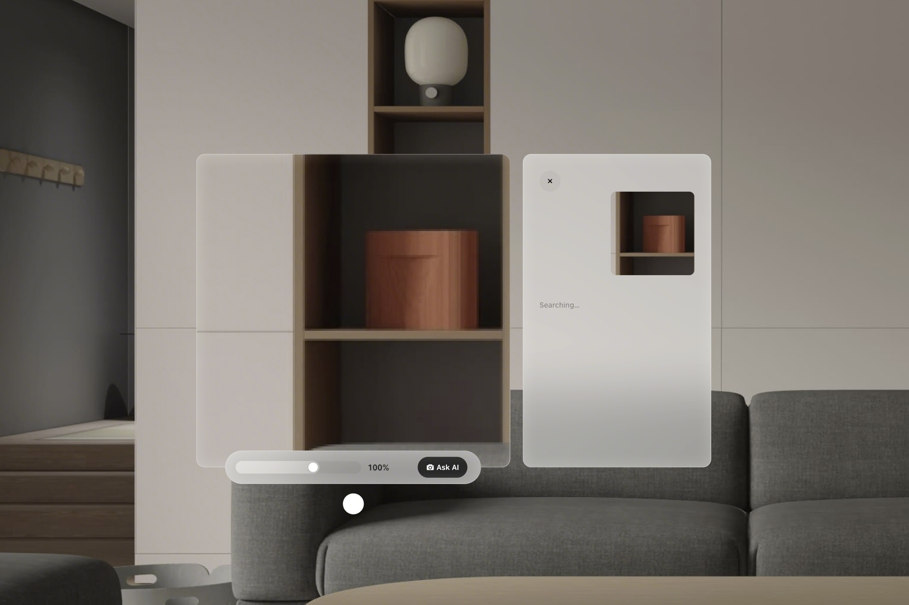

# Spatial ML

[English](README.md) | [简体中文](README_zh.md)

A reference application built with the PICO Spatial SDK that demonstrates SpatialML capabilities for
spatial applications on PICO OS 6. These SpatialML samples serve as practical guides for developers,
showcasing the functionalities for CV algorithm deployment, multi-modality spatial data as
algorithm inputs, hardware acceleration for local machine learning inference, async readback of
algorithm output data, permission handling, and the distinctive _SpatialML_ isolated sandbox
environment which offers a comprehensive protection of user privacy while unleashing app's MR
creativity.



## Features

The project provides nine independently runnable Android application targets while keeping every
target on the published Spatial SDK `6.1.9` BOM:

- **Super Resolution — Programmatic** builds its graph with Kotlin SpatialML APIs.
- **Super Resolution — Pipeline** loads the equivalent graph from a schema-v2 pipeline package.
- **Stylized Camera — Programmatic** builds style prediction and transfer with Kotlin APIs.
- **Stylized Camera — Pipeline** loads style prediction and transfer from a pipeline package.
- **MediaPipe Face — Pipeline** loads face detection and SpatialML frame-display pipelines.
- **Face Landmarker — Full Space** ports the Unity XR tracker with 478 landmarks, a deforming
  face mesh in stage coordinates with passthrough, and 52 blendshape scores. SpatialML uses a zero-sized container;
  the app reads back the results and owns the Stage mesh. See [the sample guide](FaceLandmarkerApp/README.md).
- **Face Registration Lab**: A/B/C camera experiments, exact camera/model input captures, and independent checkerboard calibration for diagnosing mesh offsets. See [the lab procedure](FaceRegistrationLabApp/README.md).
- **Pose — Pipeline** runs schema-v2 pose inference and renders the original-style stick figure
  with 13 blue joints and 14 white limbs in an Automatic Stage. SDK 6.1.9 uses independent marker
  entities because the newer `SkeletonPoseComponent` skinned-mesh API is not published in that BOM.
- **MNIST Wild — Pipeline** recognizes handwritten digits from VST camera crops and renders the
  crop, class, and confidence on three Stage monitors.

The Pose and MNIST packages preserve SpatialSDK's models, scripts, bindings, and graph order. Their
pipeline JSON uses the equivalent `XR_SECURE_MR_OPERATOR_TYPE_JAVASCRIPT_PICO` spelling required by
the `6.1.9` loader instead of the newer `XR_SECURE_MR_OPERATOR_TYPE_JS_SCRIPTING_PICO` alias.

The Super Resolution samples:

- _Deploys_ a real-time neural-network-based SuperResolution model, to zoom in the see-through camera images,
- _Provides_ two modes: the Relax and SpatialML modes: the former requires camera permission from users,
  whereas the latter adopts the _SpatialML_ sandbox, providing zooming effect while protecting users
  privacy,
- _Implements_ a large-language-model-based visual-question-answer (VQA) interface in RelaxMR mode,
  which allow users to launch a VQA query on the zoomed camera images, using your LLM backend of
  your own choice, and
- _Showcase_ how to use Kotlin co-routines to asynchronously invoke the SpatialML APIs.

## Requirements

To build and run this project, configure your development environment by following the official PICO Spatial SDK setup guide:

- [PICO Spatial SDK Setup Guide (Outside Chinese Mainland)](https://developer.picoxr.com/document/spatial-sdk/set-up-development-environment/)
- [PICO Spatial SDK Setup Guide (Chinese Mainland)](https://developer-cn.picoxr.com/document/spatial-sdk/set-up-development-environment/)

## Getting Started

### 1. Clone the Repository

```bash
git clone <repository-url>
cd SpatialML
```

### 2. Open in Android Studio

Launch Android Studio, select **Open an Existing Project**, and choose the `SpatialML` directory.

### **[Optional]** Apply for ByteDance Volcano API Key

As is mentioned above, the SuperResolution Demo App come with a LLM-based VQA interface, at [`SuperResolutionApp/src/main/java/com/pico/spatial/ml/sample/sr/vm/VQAWrapper.kt`](SuperResolutionApp/src/main/java/com/pico/spatial/ml/sample/sr/vm/VQAWrapper.kt). The built-in implementation to that interface uses the Volcano Cloud Engine as its backend. In
order to use the VQA feature out-of-box, you may need to apply for a Volcano API key.

Then, connect to the PICO device, ensure the USB debugging is enabled on that device, and run

```bash
adb shell setprop debug.spatialml.apikey <API-KEY>
```

If no API Key is provided, when you launch the app and enter _RelaxMR_ mode,
you will find the "Ask AI" button not clickable.

### **[Optional]** Replace the Volcano LLM backend with VQA APIs of your own choice

Instead of applying for a Volcano API key, you can also replace the default implementation of the
VQA interface with any VQA backend of your own choice. The only requirement is the VQA backend
should provides RESTFul API calls.

You can refer to the sample codes in [`SuperResolutionApp/src/main/java/com/pico/spatial/ml/sample/sr/vm/VQAWrapper.kt`](SuperResolutionApp/src/main/java/com/pico/spatial/ml/sample/sr/vm/VQAWrapper.kt), where the default implementation is defined:

```kt
val ark
    get() = create<FileUploadResponse, QueryResponse>(
        // ...
    )
```

### 3. Run on Device

PICO Emulator _DOES NOT_ support SpatialML features, so a PICO device with PICO OS 6 is required.

1. Connect your PICO device to your development machine
2. Enable **USB Debugging** on the device
3. Sync the project with Gradle files so Android Studio discovers all nine application modules
4. Choose one application module from the Android Studio run-target selector and deploy it
5. You can filter the logcat logs using `SpatialML::Server` tag to capture the logs at run time.

## Project Structure

Each sample is an independent Android application module with its own package, manifest, assets,
APK, and Android Studio run target:

```bash
SpatialML/
├── SuperResolutionApp/                 # Programmatic Super Resolution
├── SuperResolutionPipelineApp/         # Pipeline-package Super Resolution
├── StylizedApp/                        # Programmatic Stylized Camera
├── StylizedPipelineApp/                # Pipeline-package Stylized Camera
├── FaceMediaPipePipelineApp/           # MediaPipe face pipeline
├── FaceLandmarkerApp/                  # Full Space face landmark mesh with passthrough
├── FaceRegistrationLabApp/             # Camera/Stage registration measurement lab
├── PosePipelineApp/                    # Pose pipeline and Stage marker rendering
├── MnistWildPipelineApp/               # MNIST Wild pipeline and Stage monitors
├── common/                             # Shared non-runnable sample helper library
├── shared-assets/                      # Assets shared by matching programmatic/pipeline apps
├── buildSrc/                           # Shared sample-application Gradle convention
├── gradle/                               # Gradle dependencies and scripts
├── build.gradle.kts                      # Root build configuration
└── settings.gradle.kts                   # Project settings and SDK setup
```

Build all nine APKs with:

```bash
./gradlew assembleDebug
```

## Learning Resources

To deepen your understanding of spatial app development, explore the comprehensive resources on our official developer websites:

- [PICO Developer Website (Outside Chinese Mainland)](https://developer.picoxr.com/)
- [PICO Developer Website (Chinese Mainland)](https://developer-cn.picoxr.com/)

## License

© 2026 PICO. The project's source code is licensed under the [Apache 2.0 License](LICENSE.txt). All assets, including textures, 3D models, audio, and others, are licensed via [Creative Commons BY 4.0](https://creativecommons.org/licenses/by/4.0/).

## Support

For questions, issues, or feature requests, please contact us through the [PICO Developer Support Portal](https://picodevsupport.freshdesk.com/support/home) and submit a ticket.

---

Developed as a reference for spatial application developers
